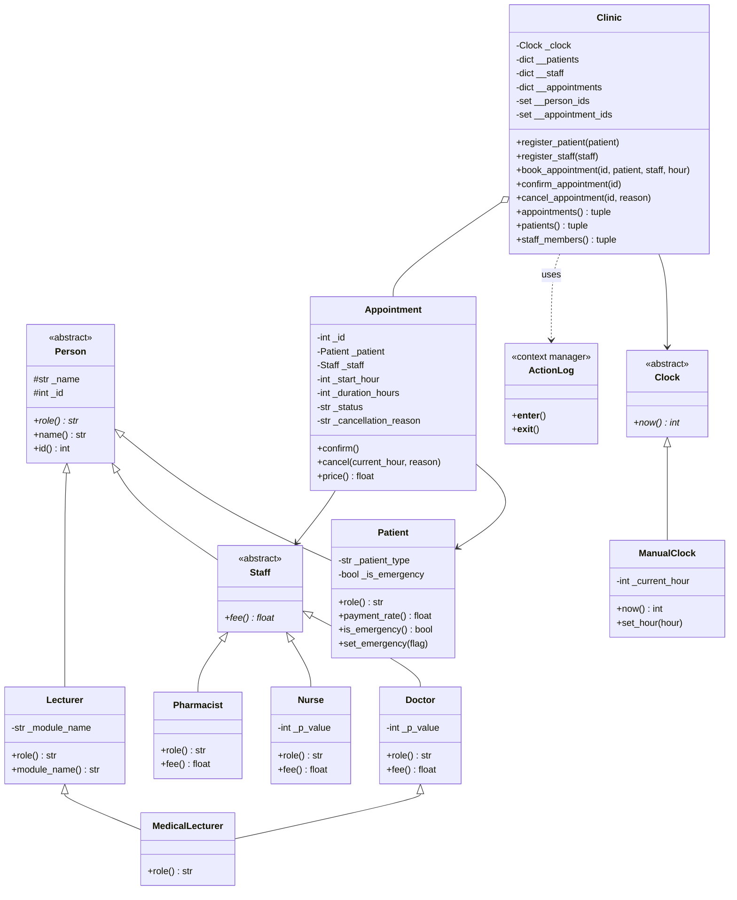

# Clinic Appointment System (Python)

## Group Members

- Rolland Zumba, Student ID r2420373 (P = 2420373, used for all fee and twist calculations)
- Litchel Mutekesa, Student ID R2420433
## Assignment Information

- Student ID: r2420373 (P = 2420373)
- Fee calculation parameters:
  - P mod 5 = 2420373 mod 5 = 3, so Doctor fee = 40 + 5 x 3 = **$55**
  - P mod 3 = 2420373 mod 3 = 0, so Nurse fee = 10 + 0 = **$10**
  - Pharmacist fee = fixed at **$5**
- Assigned twist: P mod 4 = 2420373 mod 4 = **1**, which is **Emergency Booking**
- Execution: `python main.py`

## Project Structure

- `clinic.py`: Core domain classes, clock abstraction, validation, cancellation invariants, audit-log context manager, emergency-booking twist, and polymorphism.
- `main.py`: Executable demonstration of all required features, including deliberate and expected failures.
- `appointment_log.txt`: Audit log generated at run time by every clinic action (appended on each run).

## Class Diagram



`MedicalLecturer.fee()` is not redefined: it is inherited from `Doctor` through the method resolution order.

## Class Invariants

**Appointment invariants** (also written as comments above the class):

1. `_id > 0`: a strictly positive integer.
2. `_patient` is a `Patient` and `_staff` is a `Staff`.
3. `0 <= _start_hour < 168`: the start hour lies within the one-week calendar.
4. `_duration_hours == 1`: every appointment lasts exactly 1 hour.
5. `_status` is one of `"PENDING"`, `"CONFIRMED"`, `"CANCELLED"`.
6. Once `CANCELLED`, the state is terminal and can never change back.
7. Only `PENDING` can transition to `CONFIRMED`.
8. If `_status == "CANCELLED"`, `_cancellation_reason` is a non-empty string.

**Clinic invariants** (also written as comments above the class):

1. All registered person IDs and appointment IDs are globally unique and disjoint.
2. Every key in `__patients` equals the `id` of its patient, and likewise for `__staff` and `__appointments`.
3. For any given hour, no patient and no staff member has more than one active (non-cancelled) appointment.
4. Internal collections (`__patients`, `__staff`, `__appointments`, `__person_ids`, `__appointment_ids`) are never returned directly; accessors return immutable tuple snapshots.
5. Every state-changing action is recorded through the audit-log context manager.

## Encapsulation and State Rules (Q2)

**Hiding fields.** All fields are underscore-prefixed and exposed only through read-only properties. Clinic's collections use name-mangled double-underscore names. Query methods return tuple snapshots, never the internal dicts, so callers cannot change Clinic's state through them.

**Legal status transitions.**

| From | To | Allowed when |
|---|---|---|
| PENDING | CONFIRMED | Always (`confirm()`) |
| PENDING | CANCELLED | Before the start hour |
| CONFIRMED | CANCELLED | At least 2 hours before start, and not yet started |
| CONFIRMED | PENDING | Never |
| CANCELLED | any state | Never (terminal) |

Every transition goes through `Appointment.confirm()` or `Appointment.cancel()`, which raise `AppointmentStateError` on an illegal change. The status is never assigned from outside the class.

**Constructor validation.** `Person.__init__` rejects names that are not strings or are empty after `strip()`, and IDs that are not positive integers (booleans are excluded). `Appointment.__init__` applies the same style of check to its ID and start hour (0 to 167) and verifies its patient and staff arguments. All failures raise `ValidationError`, so an invalid object is never created.

## Polymorphic Fees (Q3)

`print_staff_fees()` loops over the staff and calls `member.role()` and `member.fee()`. There is no `isinstance`, type tag or branching on class anywhere in the loop. `Staff` declares `fee()` as abstract, so a new subclass must implement it, and the loop and `Clinic` work with it unchanged. The `Pharmacist` class (D3) proves this.

## Audit Log (Q4)

`Clinic` wraps every action in `with ActionLog(...)`. The mechanism is a **context manager** (`__enter__` / `__exit__`), which the `with` statement runs exactly once per action:

- `__enter__` opens the file and prints `[log] opened`.
- `__exit__` always runs, even when the action raises. It writes `SUCCESS <action>: completed` or `FAILED <action>: <reason>`, closes the file in a `finally` block, and prints `[log] closed`.

Example from `appointment_log.txt`:

```
SUCCESS book appointment #1: completed
FAILED cancel appointment #10: A confirmed appointment must be cancelled at least 2 hours before start.
```

## Multiple Inheritance (Q5)

`MedicalLecturer(Doctor, Lecturer)` has the MRO `MedicalLecturer, Doctor, Staff, Lecturer, Person, ...`. Every constructor in the chain uses cooperative `super().__init__(...)`, so `Person.__init__` runs once. The class-level counter `Person.constructor_calls` shows this: `main.py` prints **1** for the creation of one `MedicalLecturer`. `role()` returns `"Doctor and Lecturer"`, and `fee()` is the Doctor fee (see D4).

**Java note.** This project is written in Python, so no restructuring was needed. In Java, `MedicalLecturer` could not extend both `Doctor` and `Lecturer`, because a class has only one parent. `Lecturer` would become an interface (for example with `getModuleName()`), and `MedicalLecturer` would `extend Doctor implements Lecturer`. Only one class chain then reaches `Person`, so its constructor runs once, and `MedicalLecturer` overrides `role()` to return "Doctor and Lecturer".

## Design Decision Log

### D1: Where does the 2-hour rule live?

The rule lives inside `Appointment.cancel()`, alongside the "already started" and "already cancelled" checks.

Alternatives considered:

- **Clinic:** Clinic owns the clock and could check the rule before cancelling. But any code holding an `Appointment` reference could then bypass the rule, so the invariant would depend on every caller going through Clinic.
- **Staff:** Rejected. Staff know their fee and role, not the lifecycle of an appointment, so the rule would couple unrelated concepts.
- **Separate policy object:** The most flexible option, since the notice period could be configured without editing `Appointment`. The cost is extra indirection, and `Appointment` would still have to call the policy, otherwise the rule is again bypassable.

Trade-off: placing the rule in `Appointment` guarantees the invariant everywhere and keeps the status and start hour together. The cost is that the 2-hour value is hard-coded. The clock stays injected at Clinic level, which passes `now()` into `cancel(current_hour, ...)`, so `Appointment` never reads time itself.

### D2: Why is the clock design testable, and what could not be tested with system time?

- **Testable because:** the clinic depends on an abstract `Clock` interface (`now()`). By injecting `ManualClock`, tests can advance or rewind time to hit exact boundaries (for example 1 hour before vs. 2 hours before the start, or the exact start hour).
- **Not testable with system time:** with `datetime.now()` or `time.time()`, testing start times, 2-hour notice deadlines or week-long scenarios (hours 0 to 168) would need fragile `sleep()` calls or monkey-patching of system modules, which is slow and non-deterministic.

### D3: When Pharmacist was added, what changed besides the new class?

Only the new `Pharmacist` class was written (subclassing `Staff`, with `fee()` returning 5 and `role()` returning "Pharmacist"). **Nothing leaked.** The staff-fee loop, registration in `Clinic` and appointment booking all work through polymorphism, with no `isinstance` checks and no edits to existing logic.

### D4: What should MedicalLecturer.fee() return, and what stops Person being created twice?

- **Fee:** `MedicalLecturer.fee()` returns the Doctor fee, 40 + 5 x (P mod 5) = **$55.00**, inherited through the MRO from `Doctor`. A medical lecturer consulting at the clinic charges the specialist clinician rate.
- **Language feature:** Python's C3 Method Resolution Order combined with cooperative `super().__init__(name, person_id, **kwargs)`.
- **Without it:** calling `Doctor.__init__` and `Lecturer.__init__` directly would run `Person.__init__` twice. Base fields would be initialised twice and the construction counter would be double-incremented, so the second run could overwrite state set up by the first.

### D5: What should happen if writing to or closing the log itself fails?

- If opening the file fails in `__enter__`, the operation does not proceed and a `LogError` is raised.
- If writing or closing fails in `__exit__`, the exception is caught, cleanup is attempted in a `finally` block, and a `LogError` is raised.
- Reason: audit logs support non-repudiation and compliance in healthcare systems. If the log cannot be durably written, the system must fail loudly rather than report an unlogged action as safe.
- Limitation: if the failure happens in `__exit__`, the action's state change has already been applied and is not rolled back. The `LogError` tells the caller that the action was not safely recorded.

### D6: Twist (P mod 4 = 1, Emergency Booking): why can't a confirmed appointment be bumped?

A CONFIRMED appointment is a binding clinical commitment to a patient who may already be travelling, preparing for treatment or relying on guaranteed care. Bumping confirmed patients would cause clinical and operational instability. Emergency patients therefore supersede only tentative PENDING reservations, which are cancelled with the reason `"bumped"`. If every slot is confirmed, the clinic must use on-call staff or an escalation pathway rather than silently cancelling confirmed visits.

## 5-Minute Live Demo Outline (Q8)

1. **Start:** run `python main.py`. Point out P = 2420373, the modular results, Doctor fee $55 and Nurse fee $10.
2. **Polymorphism:** show STAFF FEES printed by a single loop with no `isinstance`.
3. **Diamond inheritance:** show the `MedicalLecturer` details, the MRO, and "Person constructor calls for this object: 1".
4. **Regular booking and confirmation:** Alice books and confirms at hour 15; the student 50% discount is applied.
5. **Twist (Emergency):** Brian books at hour 16 (PENDING); Emily (emergency) books hour 16 and Brian's appointment is CANCELLED with reason "bumped".
6. **Deliberate failure 1 (emergency vs. confirmed):** Frank (emergency) tries to bump Alice's confirmed appointment at hour 15 and is rejected cleanly.
7. **Deliberate failures 2 (cancellation rules):** a late cancellation (under 2 hours) and a cancellation after the start both fail cleanly; cancelling an already cancelled appointment also fails.
8. **Validation and terminal state:** an empty patient name and a non-positive ID are rejected; confirming a cancelled appointment fails.
9. **Audit log:** show the `[log] opened` / `[log] closed` lines on the console and inspect `appointment_log.txt`, which contains both SUCCESS and FAILED records.
